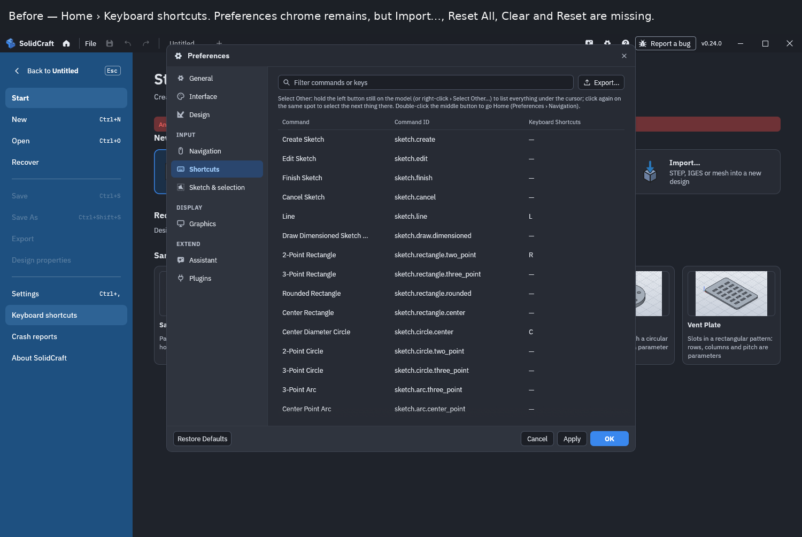
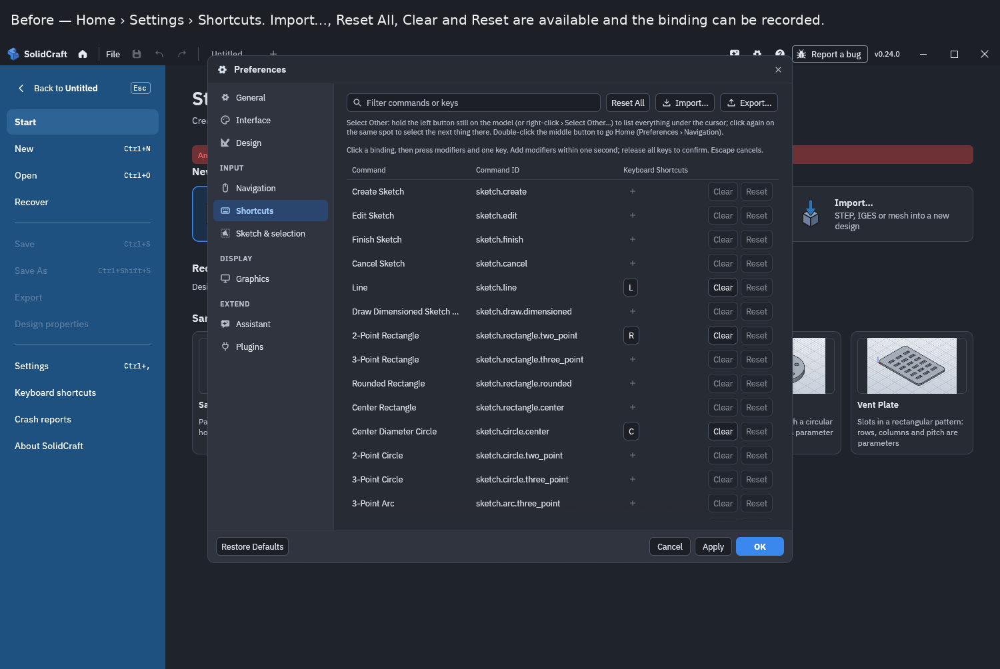
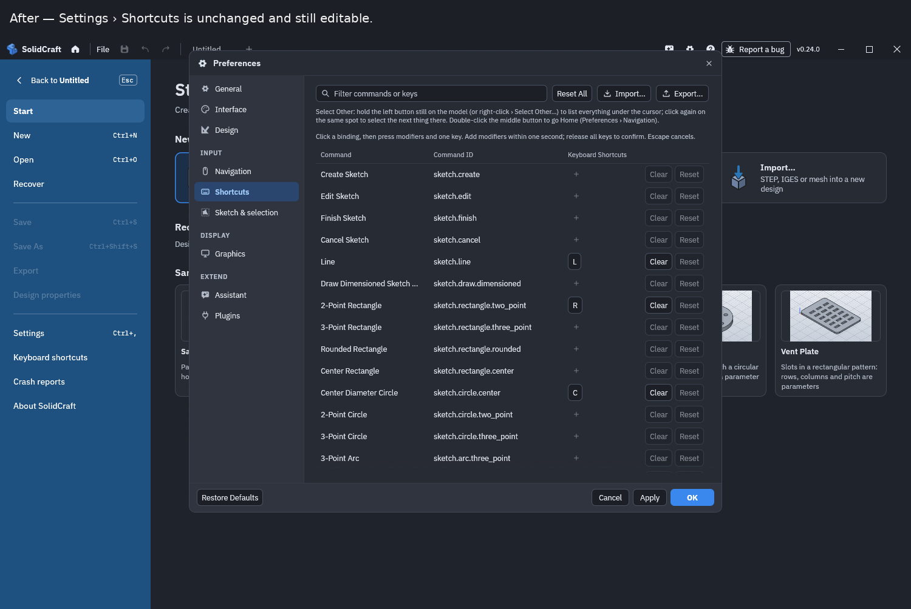

# Home › Keyboard shortcuts opens the editable Shortcuts page (#7409)

## Change

Home › Keyboard shortcuts opened the Shortcuts page of Preferences in the read-only mode used by Help › Keyboard Shortcuts. The window still had the title Preferences, the full settings sidebar, and Cancel / Apply / OK, but Import…, Reset All, Clear, and Reset were hidden and bindings could not be clicked. Nothing on the page said it was read-only, so it looked like Settings › Shortcuts with the edit controls missing.

Home sits beside Settings, and File › Keyboard Shortcuts already opens the editor. Home now uses that same action (`toolbar::FileAction::Shortcuts`), so the page opens editable: Import…, Reset All, Clear, Reset, and click-to-record. Settings › Shortcuts is unchanged. Help › Keyboard Shortcuts stays the read-only list.

Fixes #7409

Changes a default: no

## Validation

`cargo +1.95 test -p solidcraft-ui-egui --lib -- home_keyboard_shortcuts_open_the_editable_page help_shortcuts_card_keeps_rebinding_read_only shortcut_card_captures_clears_resets_and_esc_cancels_capture_only preferences_and_shortcuts_open_over_home`

Result: 4 passed.

- `home_keyboard_shortcuts_open_the_editable_page` clicks Home › Keyboard shortcuts and checks the Shortcuts page is editable (Import…, Reset All, and capture / clear / reset), then opens Settings › Shortcuts and checks that page is still editable.
- `help_shortcuts_card_keeps_rebinding_read_only` still refuses rebinding from Help.
- `shortcut_card_captures_clears_resets_and_esc_cancels_capture_only` still records, clears, and resets a binding from Settings › Shortcuts.
- `preferences_and_shortcuts_open_over_home` still draws Preferences over Home.

The desktop app was run under Xvfb (`solidcraft --control`, Vulkan via lavapipe) and driven through the control channel: `ui.home`, then a click on `home:shortcuts`, then `home:settings` and `prefs:page:Keyboard Shortcuts`. Screenshots below are those windows, captured once on the previous Home path and once with this change.

## Screenshots of the behavior (when observable)

Repro: Home › Keyboard shortcuts, then Home › Settings › Shortcuts. The dialog is Preferences in both cases. The difference is whether the shortcut list can be edited.

Before. Home › Keyboard shortcuts still looks like Preferences (sidebar, Cancel / Apply / OK) but the list is read-only: no Import…, no Reset All, no Clear or Reset, and the binding is plain text.

Before. Home › Settings › Shortcuts on the same build has Import…, Reset All, Clear, and Reset, and the binding is a button.

After. Home › Keyboard shortcuts opens that editable page.

After. Settings › Shortcuts is unchanged.

## Integration status

Branched from tangency-labs/solidcraft `main` at `84a3a0c47801bacbf1eef15fbb6073f73c854940`. No pull request was opened against tangency-labs/solidcraft, and the upstream issue was not commented on. This file is the draft to open there later.
