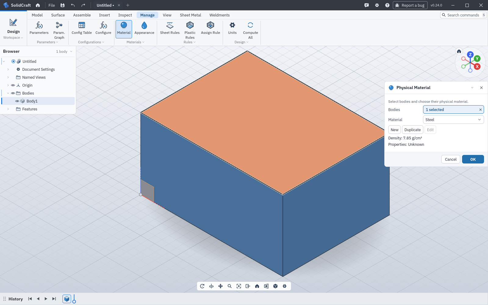

# Physical Material dialog shows the body's material (#7433)

Fixes #7433

## Change

Reopening Physical Material (`material.assign`) always showed Steel, the library row at index 1. The body's colour and Properties already used the assigned material. The dialog now opens on that material.

A 40 × 30 × 20 mm box assigned Copper still reports Copper in `component.properties`. Opening Physical Material on that body used to show Steel and 7.85 g/cm³. It now shows Copper and 8.96 g/cm³. OK assigns the material the dropdown shows. Cancel does not change the design. With no bodies, or with bodies that do not share one material, the dropdown stays empty (`Choose a material` / `Different materials`) and OK stays disabled until a material is chosen. A material picked in the dialog is kept by name if the targets change.

Changes a default: no

## Validation

`cargo test -p solidcraft-ui-egui --lib -- material_dialog physical_material`

10 passed, 0 failed (0.28s):

- `material_dialog_opens_on_the_bodys_material`
- `material_dialog_follows_targets_until_a_material_is_chosen`
- `physical_material_dialog_shows_the_bodys_material` (opens on Copper, Cancel leaves the document unchanged, choosing Aluminum and OK assigns it, Properties follow, reopening shows Aluminum)
- `physical_material_is_dense_and_keeps_assignment`
- `physical_material_panel_reviews_saved_si_card_without_changing_the_design`
- `physical_material_clicked_save_then_cancel_persists_without_assigning_or_changing_mass`
- `physical_material_discard_and_invalid_save_leave_document_and_history_unchanged`
- `physical_material_editor_preserves_all_sources_conditions_anisotropy_and_pbr_on_rename`
- `physical_material_duplicate_preserves_visual_values_and_keeps_builtin_immutable`
- `physical_material_draft_rejects_invalid_constants_and_stale_edits_atomically`

App, software Vulkan, 1600×1000, light docked layout:

1. `solid.box` 40 × 30 × 20 mm, then `material.assign` Copper on Body1.
2. `component.properties` reports `"Copper"`.
3. Select Body1 and `ui.start` `material.assign`.

Unfixed parent `84a3a0c47801bacbf1eef15fbb6073f73c854940`: the dialog's Material row is Steel and the density line is 7.85 g/cm³. Fixed build: the Material row is Copper and the density line is 8.96 g/cm³. The body stays copper coloured in both shots.

## Screenshots of the behavior (when observable)

Steps above. Expected: the dialog shows the body's current material. Actual before the fix: Steel. Actual after the fix: Copper.

## Integration status

Branch `cursor/physical-material-dialog-7433-efcf` is based on upstream `main` `84a3a0c47801bacbf1eef15fbb6073f73c854940` ("Regenerate generated files and fold pending files [skip ci]"). No upstream pull request was opened. This draft is the body to use when one is opened against tangency-labs/solidcraft.
